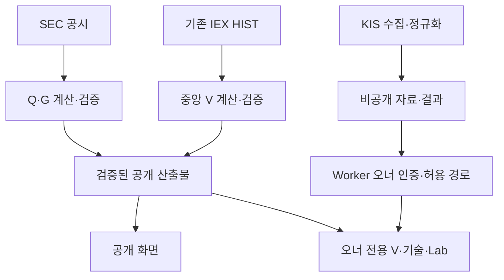

# 투자시스템 아키텍처

> 검토 초안 · 2026-11-15. 전체 구조와 전환 상태의 안내이며 계산식·권한·배포를 변경하지 않는다.
> 코드 기준: 기본 가지 `claude/investment-system-top500-validation-alrugm`, `719e23a042d2c737fe408844bf89ccbe081fac39`.
> 목표 기준: 이 초안 작성을 요청한 2026-11-15 오너 지시. 기본 가지에 없는 결정과 Draft 구현은 아래에서 구분한다.

## 1. 범위와 문서 역할

투자시스템은 기업의 QGV, 기술적 분석, 매크로를 공통 기업 문맥으로 연결하고 포트폴리오와 Lab에서 검증한다.
새 엔진이나 별도 기능 계층을 추가하지 않고 기존 계산·자료·계약을 재사용한다.

- [기능 계층](docs/SPEC/FUNCTION_HIERARCHY_v1.0.md)은 제품의 1~9 번호와 요구사항 원문이다.
- [방향 전환 대장](docs/SPEC/DIRECTION_CHANGES.md)은 승인된 결정과 변경 이력이다. 이 초안은 결정 번호를 부여하지 않는다.
- **전체 구조의 운영·통합·보류·과도기 예외 표는 이 문서 8절에서 관리한다.** 다른 문서에는 표를 복제하지 않고 연결한다.
- [기능 현황](docs/SPEC/FUNCTION_STATUS.md)은 세부 기능별 구현 근거, [인수인계](CURRENT_HANDOFF.md)는 작업·PR·배포 증거를 유지한다.
- 상세 계약의 산식·스키마는 각 계약이 관리한다. 이 문서에서 새 기본값이나 누락값 대체 규칙을 만들지 않는다.

## 2. 제품 구조와 공통 문맥

다음은 요구사항상의 기능 관계이며 각 연결의 구현 완료를 뜻하지 않는다. 현재 상태는 8절과 기능 현황을 따른다.

| 기능 계층 | 사용자 업무 | 다른 영역과의 연결 |
| --- | --- | --- |
| 1. 홈 · 기업검색 | 기업 찾기와 상세 진입 | 선택 기업을 2·3·4·5에서 유지 |
| 2. QGV | 리더보드·가중치·기업 상세·요소 설명 | 6의 후보와 9의 실험 입력 |
| 3. 기술적 분석 | 지표·패턴·시나리오·노트 | 기업의 증권·가격 계열, 6·9의 실행/위험 검토 |
| 4. 매크로 | 경기·시장 국면, 순환매, 산업 사이클 | 분류와 근거를 통해 기업·산업·포트폴리오 문맥 연결 |
| 5. 뉴스 · 공시 · 관계망 | 사건·지배·지분 관계의 근거 탐색 | 1·2·4의 설명에 연결, 예상 영향을 공식 점수로 간주하지 않음 |
| 6. 포트폴리오 | 모델·실제·모의 구성과 추적 | QGV 후보, 기술·매크로 검토, 7의 보고 도움, 9의 평가 |
| 7. 프롬프트 라이브러리 | 목적별 탐색·복사·내 사본 | 각 화면의 설명과 자료 부족을 연결 |
| 8. 전체 내용구성 트리 | 자료·계산·판단 관계 탐색 | 다른 영역의 설명을 연결하며 계산을 복제하지 않음 |
| 9. Lab | 백테스트·전진검증 | 버전이 고정된 입력·설정·모집단으로 결과 재현 |

공통 문맥은 기업 이름이나 티커 하나로 대체하지 않는다.

- 발행사(`issuer`), 증권·종류주(`security`), 상장 코드(`listing`/행 ID)를 분리한다. 같은 발행사의 여러 코드 행을 임의로 합치지 않는다.
- 공통 섹터·하위 산업·원천 SIC·회계모형·태그·ETF 대응은 서로 다른 속성이다. 섹터만 알면 회계모형도 확정됐다고 보지 않는다.
- 분류 기록 ID·해시·버전·유효기간과 평가일을 함께 대조한다. 화면 이동이나 발행사 보완이 불일치를 덮어쓰면 안 된다.
- 매크로 통계의 산업 정의는 별도 원천·버전으로 대응한다. SIC나 ETF 이름의 유사성만으로 같은 산업으로 간주하지 않는다.
- 지배 관계와 지분 보유, 지분율과 의결권을 구분한다. 관계망은 별도 점수 엔진이 아니다.
- 평가 모집단·참조 모집단·순위 집단·화면 필터를 분리한다. 필터가 저장 점수·원순위·원래 분모를 바꾸지 않는다.

현재 공식 모집단은 고정 Universe504다.
교체 목표는 검증된 시가총액 상위 500 **고유 발행사**이며 아직 전환 전이다.
전환 전후와 확장 연구의 모집단 ID·버전·구성원 해시를 분리하고 과거 결과를 보존한다.
종류주 합산·대표 증권·평가일 시총·후보 범위 완전성이 입증되지 않으면 전체시장 Top500 확정으로 표시하지 않는다.
504코드와 501발행사, 보유 표본과 관측 카탈로그를 더하지 않는다. 전체시장 분모 미확정은 `null`이다.

## 3. 자료 흐름과 공개·비공개 경계

아래는 승인된 목표 경로다. 각 경로의 현재 구현·배포 확인 범위는 8절을 따른다.

공통 처리 순서는 다음과 같다. 같은 코드 재사용과 같은 자료 공개 권한은 별개다.

1. **공급처·수집:** 공급처별 허용 범위와 실행 승인을 적용하고 수집 성공·실패·원문 위치를 기록한다.
2. **정규화:** 기간·통화·단위·보통주 귀속·종류주·가격 조정 기준을 연결한다. 결측을 0으로 채우지 않는다.
3. **검증:** 증권 신원, 기업행사, 자료 가용시각, 입력·설정·모집단·분류 해시와 계약 버전을 확인한다.
4. **계산:** 기존 커널로 원지표 → 요소 → 역할 → 축 → 자격/총점을 산출한다. 기술·매크로·Lab도 각 계약의 조건을 사용한다.
5. **저장·전달:** 원본·검증 결과·manifest와 재현 입력을 보존하고 공개용 투영 또는 인증된 비공개 전달본을 만든다.
6. **화면:** 판독기가 계약을 확인한 결과만 표시한다. 부분 실패·미산출·갱신 지연과 마지막 정상본을 구분한다.

공개 Q·G는 SEC 기반 경로, 공개 V는 기존 IEX 중앙 경로를 유지한다. 새 가격 공급처 도입은 보류한다.
IEX 수집이 실패하면 마지막 정상 중앙 V와 원래 가격 기준일·실패 상태를 유지한다. 실패한 날을 새 가격 날짜로 쓰지 않는다.
KIS의 가격·V·기술적 분석·Lab 실자료 결과는 지정 오너 전용이다. 공개 V의 결손을 KIS로 채우지 않는다.
공개 화면은 비공개 자료 없이 동작해야 한다. 비오너의 로그인 성공도 KIS 접근 허용을 뜻하지 않는다.
내 시트 V의 추가 개발은 보류한다. 이 지시는 기존 코드·저장 자료의 삭제나 공식 경로 전환을 의미하지 않는다.
기술·Lab의 실제 이용을 비공개로 모으는 방향과, 기존 공개 설명·합성 화면의 철거 완료를 혼동하지 않는다.

## 4. 계산과 결과의 비교 범위

| 결과 종류 | 기준 | 저장·사용 경계 |
| --- | --- | --- |
| 공식 | 승인된 산식·입력·모집단·관문·가격 출처 | 공식 게시본·후보·원장에 사용; 연구 결과로 자동 교체하지 않음 |
| 연구 U1-555 | 공통 Q·G·V 각 5역할, 공통 비교 정의 | 같은 계약의 적격 집단에서 비교; 회계 적용 한계를 별도 표시 |
| 연구 S1-555 | 섹터·회계모형별 5역할과 해당 축 비중 | 섹터 내 비교; 섹터 점수를 이어 붙여 통합 순위로 만들지 않음 |
| 사용자 설정 | 허용 지표·역할·축 비중을 변경한 설정 버전 | 실제 활성 역할과 기본값 차이를 표시; 공식 결과·저장 기본값을 덮어쓰지 않음 |

555는 Q·G·V의 **5역할씩**을 뜻한다. 한 역할에 여러 원지표가 있어도 독립 역할 수가 늘어나는 것은 아니다.
333 추가 진행은 중단 방향이며 기존 연구 이력은 남긴다. 555를 기존 공식 모형으로 자동 승격하지 않는다.
기본 가중치와 사용자 가중치, 유효 입력 비중과 재배분 후 적용 비중, 관문 전후 기여를 구분한다.
정보 중복은 원자료·경제적 의미의 계보와 합산 비중으로 설명한다. 임의 감점이나 근거 없는 상한을 만들지 않는다.
금융·REIT의 직접 지표·대리 지표·임시 산식·미지원 역할은 결과의 근거 등급으로 구분한다.
가격이 연결돼도 주식수·주당 기준·기업행사·시총/EV 구성·역사 입력이 부족하면 V가 완성되지 않는다.

- 각 순위·분위에 모형·설정·평가일·평가/참조 모집단·입력 버전을 고정한다. 서로 다른 결과를 하나의 순위로 합치지 않으며 전후 비교에는 달라진 조건을 명시한다.
- 요소별 **D1~D10 전체**와 유효 참조 N을 제공한다. D10이 상위이며 상위 N개 미리보기와 구분한다.
- 동점·최소 표본·결측·관문은 해당 버전의 계약을 따른다. 이 문서는 새 분위 규칙을 채택하지 않는다.
- 역할·축·세 축 동시의 커버리지를 나눠 보고한다. 부분 총점·계약상 적격 총점·15역할 완결 수를 각각 집계한다.
- 목표율은 명시된 모형·승인 조건·원래 모집단에 적용한다. 부적합 기업을 빼서 원래 모집단 목표를 달성했다고 하지 않는다.
- Lab은 전략 백테스트, 단일 기업 지표, 표본 진단을 구분한다. 산출 수 증가나 순위 변화는 투자성과 증거가 아니다.

평가일·재무 대상기간·발표·가용·취득·검토·계산·게시·조회 시각은 서로 다른 값이다.
뒤늦게 입수하거나 검토한 자료는 새 입력 버전으로 남긴다. 회고 재구성을 당시 가용했던 PIT 결과로 표시하지 않는다.
실자료/합성자료 구분도 운영 채택·배포·실환경 확인을 대신하지 않는다.

## 5. 프론트엔드와 유지할 경계

기존 화면과 새 앱의 단계 전환을 유지한다. 지금은 기능 단위 **최소 구현**으로 실자료와 계산을 연결하고, 풍부한 UI/UX는 최종 프론트 재작성 단계에 둔다(DC-56).
555·Top500, 포트폴리오, Lab의 재작성 이전 범위는 **계산·자료·계약과 숫자·표 수준의 확인 화면**뿐이다. 가중치 변경 UI, 전후 비교 탐색, D1~D10 분위 탐색 등 풍부한 화면은 그 단계에서 새로 확장하지 않는다.
자료층·엔진 연결층·검증 계약은 유지·재사용하고, 화면 재작성만을 이유로 계산·인증을 중복 구현하지 않는다.

| 층 | 현재 구현 근거 | 향후 작업 경계 |
| --- | --- | --- |
| 공개 자료 | [data.js](implementation/src/investment_system/product/web_app/data.js) | 허용 파일·동일 출처·크기 제한·기존 판독기·세대별 교체 유지 |
| 동작·상태·가격 | [action.js](implementation/src/investment_system/product/web_app/action.js), [store.js](implementation/src/investment_system/product/web_app/store.js), [prices.js](implementation/src/investment_system/product/web_app/prices.js) | 사용자 동작과 읽기/쓰기 경계 유지; 비공개 값을 공개 상태로 옮기지 않음 |
| 계산 연결 | [engines.js](implementation/src/investment_system/product/web_app/engines.js), [qgv.js](implementation/src/investment_system/product/web_app/qgv.js) | 기존 엔진·명시적 입력 재사용, 지원하지 않는 모형을 다른 모형으로 대신하지 않음 |
| 로딩·화면 | [loader.js](implementation/src/investment_system/product/web_app/loader.js), 각 screen 모듈 | 화면 재작성과 장애 격리 개선 대상; 기존 계약과 사용자 동선 보존 |

공개 자료층은 고정 파일 목록, 인증정보 제외, 리디렉션 거부, 파일당 2MiB 제한을 적용한다.
여러 파일은 기존 판독기의 묶음 검증 후 교체하며, 이전 세대의 늦은 응답으로 최신 화면을 덮어쓰지 않는다.
공통 loader가 모듈 전체 준비를 기다리는 코드는 확인했다. 비공개 모듈 실패의 실제 전파 범위는 이번 점검에서 실행 검증하지 않았다.
Main은 통합 시 비공개 자료·스크립트 실패에도 공개 화면이 뜨는지 확인하고, 구조 개선은 화면 재작성에서 다룬다.
**화면 글 규칙:** 출처·기준일·버전·산출 상태·사유는 기록에 모두 보존한다. 기본 화면은 **결과와 기준일만** 간결하게 보이고, 출처·버전·상세 사유·범위는 사용자가 누르면 펼쳐 보여준다. 결과가 없을 때는 미산출 상태를 숨기지 않는다. 내부 코드·원자료는 개발자용 상세로 분리한다.
기존 [화면 규칙](WORKING_RULES.md)을 기준으로 모바일·키보드·로딩·오류·부분 실패를 검증한다. 이번 초안은 새 시각 양식을 정하지 않는다.

## 6. 인증·Secret·배포·복구

KIS 수집 자격증명은 비공개 수집 환경, 비공개 저장소 읽기 토큰은 Worker Secret에서 관리한다.
공급처 키와 비공개 저장소 읽기 토큰은 브라우저에 전달하지 않는다. 공개 코드·파일·로그에 Secret 값·원시 KIS 가격·개인 자료를 넣지 않는다.
오너 브라우저의 KIS 가격·결과 표시는 인증된 응답과 해당 화면의 허용 처리 범위에 한정한다.
Worker는 요청마다 서버에서 Google 토큰의 대상·유효성·확인된 오너를 검증하고 허용 경로·종목만 읽는다.
응답의 `no-store`, 리디렉션 거부, 오류 본문 제한을 유지한다. 인증 실패는 다른 공개 가격 경로로 대체하는 신호가 아니다.

기본 가지 Worker의 확인된 경로는 `/history`다. `/kis/status`와 비공개 저장소 읽기 통합은 Draft 경로로 구분한다.
#549는 병합, #550은 Draft이며 무기한 토큰은 명시적 `NEVER` 계약이다. 빈 값이나 잘못된 날짜를 무기한으로 해석하지 않는다.
`NO_EXPIRY`는 만료 메타데이터 상태다. 실제 저장소 읽기 성공이나 배포 완료의 증거가 아니다.
GitHub 변수 `WORKER_READ_TOKEN_EXPIRES_ON`과 Worker 설정 `PRIVATE_REPO_READ_TOKEN_EXPIRES_ON`의 일치 확인은 Main 운영 작업이다.

병합과 배포는 별도 승인 범위다. Draft PR의 CI 성공을 운영 배포로 보고하지 않는다.
기본 가지 Worker 배포는 수동·기본 가지 조건을 따른다. `private-worker` 승인 환경 연결 #548은 병합됐지만 실설정·실배포·접근 성공 검증과 별개다.
설정 저장 → 배포 버전 확인 → 오너 읽기 → 비오너/만료 거부 → 화면 상태 확인을 각각 증거로 남긴다.
새 환경의 첫 배포와 접근 검증 전에는 옛 Secret·토큰을 제거하지 않는다. 토큰 값은 검증 보고에 포함하지 않는다.
공개 산출물과 비공개 묶음은 실패 시 검증된 정상본을 보존하고, 실패 상태·원래 시각·다음 실행의 재읽기를 분리해 확인한다.
carry 도구의 통과만으로 워크플로 적용이나 실제 사이트 복구를 완료 처리하지 않는다.

## 7. 확인 근거와 확인하지 않은 범위

직접 확인한 것은 위 기준 SHA의 코드·문서와 아래 Draft의 변경/설명이다. 이 초안 작성 중 계산·수집·배포는 실행하지 않았다.

- [SEC 일일 입력](.github/workflows/sec-daily-public-inputs.yml), [Pages 빌드·배포](.github/workflows/cockpit-pages.yml), [Worker 배포](.github/workflows/private-history-deploy.yml).
- [Worker 코드](implementation/worker/src/index.js), [비공개 구역 설계](implementation/docs/private_area/PRIVATE_AREA_NO_ZT_ACCESS_20261031.md).
- [자료층 계약](implementation/docs/frontend_v2/P1_DATA_LAYER.md), [Lab 계약](implementation/docs/lab/LAB_BACKTEST_V1_CONTRACT.md), [RIG 신원·의존성 시험](implementation/tests/test_rig_p0_foundation.py).
- 병합 [#548](https://github.com/kco994553-star/Investment-System1/pull/548): 승인 환경; 병합 [#549](https://github.com/kco994553-star/Investment-System1/pull/549): 무기한 토큰 산출 계약. 병합은 실설정 반영 증거가 아니다.
- Draft [#550](https://github.com/kco994553-star/Investment-System1/pull/550) `52c03059`: #538 위 Worker·화면 상태 확인. PR에 기재된 시험은 작성자 보고이며 이 문서에서 재실행하지 않았다.

현재 공급처 응답, 마지막 공개 가격 날짜, Cloudflare 배포 버전·Secret 반영, 오너 인증 후 실제 비공개 읽기는 이번 문서 작업에서 확인하지 않았다.
앞선 진행 보고의 실자료 수량·CI 성공을 새 SHA나 운영 환경의 증거로 전용하지 않는다.

## 8. 전체 구조 상태 — 이 표만 갱신

`IMPLEMENTED → TESTED → INTEGRATED → DEPLOYED → LIVE_VERIFIED`를 구분한다. 미착수는 `NOT_STARTED`다.
각 단계에는 해당 SHA·환경·검증 근거가 필요하다. 아래의 “현재 운영 경로”는 정본의 역할이며 이번 실환경 검증 선언이 아니다.

| 구분 | 경로·목적 | 확인 범위·현재 상태 | 종료 또는 다음 조건 | 담당 |
| --- | --- | --- | --- | --- |
| 현재 운영 경로 | SEC 공개 Q·G | 정본 수집·판독·계산 연결 확인; 최신 운영 수량 미확인 | 기존 계약과 공개 경계 유지, 실행별 증거 갱신 | Codex 자료·계산 / Main 게시 |
| 현재 운영 경로 | IEX 공개 중앙 V | 정본 경로·정상본 보존 계약 확인; 공급 중단 보고, 현재 응답 미확인 | 공급 복구와 적격 입력 검증 후 갱신; 원래 가격 날짜 보존 | Main 운영 / Codex 계산 |
| 구현·통합 중 | KIS 오너 전용 V·기술·Lab | 목표 승인; 기존 `/history` 인증 기반은 정본, KIS 전달・상태 경로는 Draft; 실제 가동 이번 미확인 | 수집·인증 전달·계산·화면 인수와 승인된 배포 후 실환경 확인 | Main 통합 / Codex 자료·계산 |
| 구현·통합 중 | 무기한 토큰·승인 환경 | #548·#549 병합, #550 Draft; 실설정·배포·오너 읽기 미확인 | 설정 일치, 실제 저장소 읽기 및 거부 경계 확인 | Main 운영 |
| 구현·통합 중 | U1-555·S1-555·사용자 설정 | 연구 생산자 #537·소비자 #538 Draft; 공식 승격 아님 | 계산·자료·계약 및 숫자·표 확인까지만; 풍부한 화면은 재작성 단계 | Codex 생산 / Main 소비 |
| 구현·통합 중 | Universe504 → 시총 Top500 | 목표는 교체, 공식은 전환 전; 실자료 확정본 이번 미검증 | 후보 풀·시총·종류주·재선정 정책 검증 및 승인; 숫자·표 확인까지 | Codex 선정 / Main 전환 |
| 구현·통합 중 | 포트폴리오·Lab | 계산·자료·계약 및 실자료 검증 미완료 | 숫자·표 확인까지 먼저; 풍부한 사용자 화면은 재작성 단계 | Codex 계산 / Main 연결 |
| 구현·통합 중 | 프론트 최소 구현 후 화면 재작성 | 자료·엔진 연결층 유지, 기존/새 화면 단계 전환 | 기능별 대체·모바일·오류 격리 검증; 게시 승인 | Main |
| 보류 | 새 공개 가격 공급처 | 기존 IEX 복구 가능성을 두고 신규 도입 보류 | 오너의 새 범위 결정 | Main / 오너 |
| 보류 | 내 시트 V 추가 개발·333 추가 진행 | 기존 이력 보존; 공개 V 대체나 삭제 승인 아님 | 필요 시 오너 재결정 | Main / Codex |
| 종료 예정 예외 | TARGET v1 빌더의 옛 V 출처 | 정본 `DEVICE_TEMPORARY`, Playbook·리허설은 `OFFICIAL_CENTRAL`; 예정 11/16 PR | Main이 전환·연장·대안을 보고하고 오너 결정 후 종료; 날짜 경과로 자동 변경하지 않음 | Main / 오너 |

## 9. Main에 넘길 불일치와 갱신 책임

다음은 기준 SHA에서 확인한 충돌 또는 이력·현행 혼재다. 이 문서 PR에서는 원문을 고치지 않는다.

1. `START_HERE.md`의 내 시트 V 항목에 KIS V 신규 연결 보류가 남아 있고 방향 전환 대장의 승인된 KIS V 범위와 다르다.
2. `FUNCTION_STATUS.md` 2.4의 비공개 V 칸 부재 설명과 KIS V 목표가 혼재한다. 구현 완료로 고치지 말고 목표와 현재를 구분해야 한다.
3. 내 시트 V 추가 개발 보류, 기술·Lab 비공개 방향, 프론트 최소 구현 후 화면 재작성은 이번 오너 지시다. Main의 결정 기록 반영이 남아 있다.
4. 비공개 구역 설계에는 작성 당시의 수집·토큰·리디렉션 상태가 남아 있다. 정본의 리디렉션 거부, Draft의 무기한 계약과 구분해야 한다.
5. TARGET V 예외의 종료 판단과 loader 실패 전파 검증은 남아 있다. 문구 수정만으로 해소됐다고 보고하지 않는다.

Main은 결정·병합·배포가 바뀔 때 근거 SHA와 이 문서 8절을 함께 갱신한다. 세부 수량·일회성 시험 로그는 인계와 해당 PR에서 관리한다.
옛 Architecture v1.0과 PRODUCT_ARCHITECTURE는 이력으로 보존한다. 이 초안의 검토·결정 번호·병합 제안은 Main이 맡는다.
## 10. 단계별 로드맵·완료 기준 (기획 범위)

아래는 기능 명세의 대체물이 아니다. 각 단계의 병합·배포·공식 채택은 별도 승인과 실제 증거를 요구한다. 개발 순서만 정하며 예상 완료일을 임의로 확정하지 않는다.

| 단계 | 이번 단계의 범위 | 완료 기준 |
| --- | --- | --- |
| **P0 구조 정리** | 승인 결정·명세·현황·인계 충돌 정리, Draft 의존성 분리 | 정본·연구·보류·실환경 상태가 일치하고 검증 근거가 연결됨 |
| **P1 KIS 비공개 연결 (DC-52, 진행 중)** | KIS 수집·정규화·가격 검증, Worker 오너 인증, Q·G/비공개 V/기술 최소 연결 | **오너가 폰에서 로그인 → 종목 검색 → Q·G, KIS V, 기술적 분석이 실제 가격으로 보이고 실환경에서 확인됨**; 비오너 거부와 공개 화면 독립 동작 확인 |
| **P2 공개 핵심 안정화** | 검색, 공개 Q·G·기존 중앙 V 상태, 뉴스·매크로 최소 동선·장애 복구 | 비로그인에서 정상 이용, STALE·미산출·실패 구분, 공개 자료만으로 동작 |
| **P3 555·Top500** | U1/S1 계산·자료·계약·커버리지·모집단 확인, 숫자·표 수준의 최소 화면 | 결과 재현·유효 분모·발행사/종류주/시총 검증; 공식 채택·Top500 전환은 별도 승인 |
| **P4 포트폴리오·Lab** | 선정·비중·백테스트·전진검증의 계산·자료·계약과 숫자·표 확인 | 실자료/합성·생존 편향·PIT 한계 구분, 적격 범위 재현·진단 통과 |
| **P5 프론트 재작성** | UI/UX 전면 재작성, 가중치 변경·전후 비교·D1~D10 분위 탐색 등 풍부한 화면 | 기존 계산·자료·인증 경계 유지, 모바일·접근성·오류 격리·회귀 검증 뒤 단계 게시 |

### Lab 자료 범위 (P4)

| 구분 | 가능 범위·한계 | 완료·보류 조건 |
| --- | --- | --- |
| **KIS 기반 우선 실험** | 실제 수집 가능한 종목·기간의 일봉 안에서 기술 지표·일부 전략을 탐색. **받을 수 있는 이력 길이는 미확인, 5년 이력은 아직 실측 전**. 현재 상장 종목 위주라 **생존 편향**이 있으며 결과마다 명시 | 실제 응답으로 종목별 날짜 범위·연속성·분할·누락을 측정한 뒤 그 범위에 한해 결과 표기; 정식 역사 성과로 포장 금지 |
| **긴 역사·시점별 재구성: 보류** | **2016년부터의 재구성**, 상장폐지 종목, 과거 시점 모집단 명부, 당시 이용 가능했던 재무·시세·기업행사 자료가 필요하며 **IEX 과거 자료 의존**이 남음 | 완전한 과거 유니버스·상폐·PIT·가격 근거 확보 전까지 종목 단위 정식 역사 백테스트 미완료 |

### 새 기능 후보 — 승인 범위 아님

아래 항목은 원문 기능계층과 현행 기능 현황에 명시된 **확정 기능으로 보지 않는다**. 별도 Draft·연구·기존 하위 구성에 일부 흔적이 있어도 기능 추가 승인이 아니다. **오너가 선택한 후보만** 추후 명세/현황에 반영한다.

| 후보 | 필요한 자료 | 계산 가능 여부·제약 | 담당 |
| --- | --- | --- | --- |
| 의외의 기업 | 회사·산업 정보, QGV 근거, 발굴 조건 및 검증 표본 | 부분 연구·Draft 가능; 실제 선정 근거와 커버리지 미검증 | Codex 계산·자료 / Main 화면 |
| 린치 6유형 태그 | 회사 사업 특성, 성장·재무 추이, 유형별 판별 근거 | 일부 규칙화 가능; 정성 판정·사람 검토 필요 | Codex 기준·자료 / Main 화면 |
| 안전마진 | FCF·할인율·성장 가정·주식수·가격·DCF 계약 | 조건부 산출 가능; 입력·가정 미충족 시 미산출, 공식 QGV와 분리 | Codex 계산 / Main 화면 |
| 무형자산·정성 분석 | R&D·특허·브랜드·인재·경영진·경쟁력 근거 | 대리지표만 부분 정량화; 정성은 점수 자동화 금지 | Codex 조사·자료 / Main 화면 |
| 기업 미션·장기 목표 | 회사 IR·보고서·공식 표현·기준일 | 원문 추출·출처 연결 가능; 투자 점수 아님 | Codex 자료 조사 / Main 화면 |
| 10섹터 추천 가중치 | 시점별 섹터/회계분류, 역할별 커버리지·PIT 성과 | 비교 연구 가능; 최적·추천값 확정 전, 임의 초기값은 검증값 아님 | Codex 비교검증 / Main 설정 화면 |
| Walk-forward·Holdout 정식 검증 | PIT 과거 입력·매 시점 모집단·상폐·가격·비용·봉인 구간 | 연구 설계·부분 계산 가능; 실자료 완결·OOS 입증 전 미완료 | Codex Lab 검증 / Main 결과 화면 |
| 기업 매출지역·사업부 비교 | SEC 지리/부문 공시, 연도·통화·사업부 변경 이력 | 공시 기업에 한해 부분 추출 가능; 전체 커버리지 미확인 | Codex 추출·검증 / Main 상세 화면 |
| Lab 스트레스·ablation·민감도 확장 | 고정된 전략 결과, 시장 국면·비용·요인별 입력 | 일부 합성 연구 가능; 실역사 성과 입증과 별개 | Codex 실험 / Main 결과 화면 |
| 일반 연구 포트폴리오 종목 수 무제한 | 대상 모집단·선정·비중·자격·중복 발행사 입력 | 계산 경로 별도 검증 가능; 책 고정 종목수 규칙과 분리 | Codex 선정·계산 / Main 설정 화면 |

## 11. 역할 경계 (문서·작업)

- **Main (Claude Code):** 프론트엔드 1~9·Worker·인증·Secret·운영·공용 가드·결정 기록·통합, 승인 범위의 병합·배포.
- **Codex:** 데이터·계산·PIT·증권 신원·연구·백테스트·재현성 검증, 해당 조사·연구 문서·Notion.
- **GPT Work:** **문서 조사·기획 정리·지시문 작성 및 문서 전용 Draft PR**. 계산·화면·운영 코드 수정, 결정 번호 부여, 승인 없는 병합·배포는 하지 않는다.

기획안 내용은 기능 명세를 자동 변경하지 않는다. 오너 선택 후 Main이 결정·명세 정합성을 관리한다.
